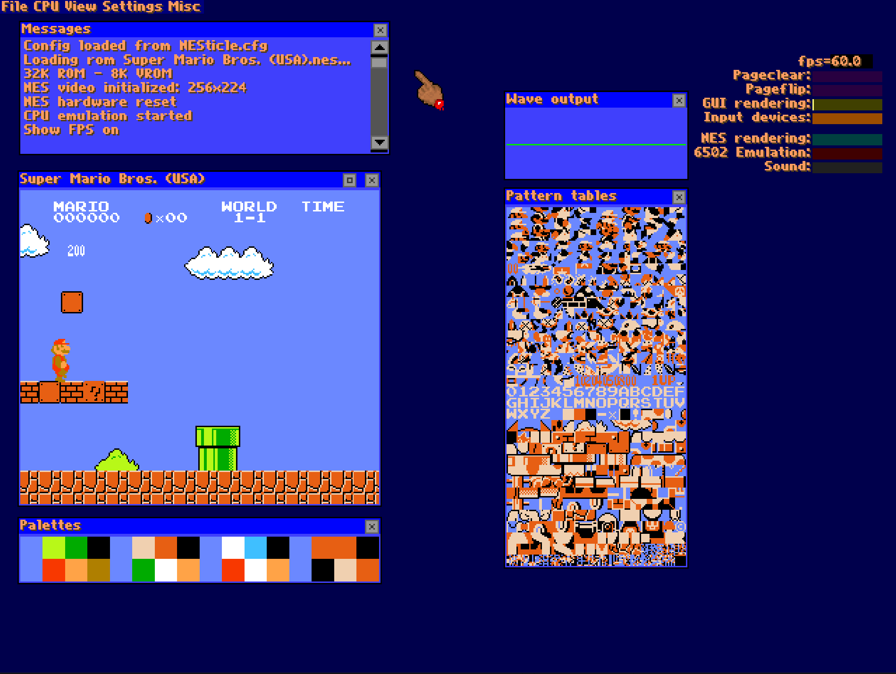

# NESticle (Modernized)

NESticle v0.2 (Bloodlust Software, 1997) ported to modern Windows via SDL3.

## Changes from Original

| Component | Original | Replacement |
|---|---|---|
| Compiler | Borland C++ / Watcom | MSVC 2022 |
| Platform | DOS / Win95 DirectDraw+DirectSound | SDL3 |
| 6502 CPU | x86 ASM core | fake6502 (public domain) |
| Rendering | x86 ASM blitters | C |
| Audio | 3-channel linear mixer | 5-channel NES DAC formulas |
| Input | Win95 keyboard | SDL3 keyboard + Gamepad |

## Controls

| Input | Action |
|---|---|
| Arrows | D-pad |
| Z / X | B / A |
| Tab / Enter | Select / Start |
| ALT+ENTER | Fullscreen |
| Gamepad | Works automatically, remappable in Settings |

## Running

Unzip and run `NESticle.exe`. Requires `gui.vol`, `NESticle.pal`, and `SDL3.dll` in the same directory (included in release).

## Current Roadmap

The SDL3 improvement branch is feature-complete for the first modernization pass: deterministic packaging, startup/shutdown hardening, settings durability, save-state validation, developer diagnostics, gamepad durability, and ROM/file UX polish.

Next work is compatibility-driven:

- Build a known-ROM compatibility matrix without bundling ROMs
- Prioritize mapper additions from observed failures
- Add developer-only timing/PPU regression traces
- Deepen audio and input verification across host devices
- Record release-candidate evidence before tagging

## Known Issues

- APU sound is the original NESticle core — not cycle-accurate
- ~8 mappers supported (MMC 0-7)
- Compatibility evidence is still manual and ROM-by-ROM

## License

NESticle is (c) Bloodlust Software / Icer Addis. This is a restoration made in good faith. If the original author objects, this repository will be taken down.

- fake6502: public domain
- SDL3: zlib license
